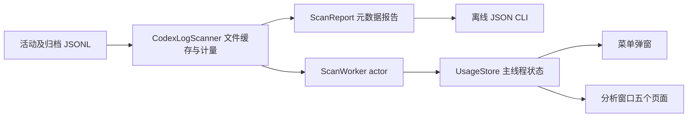

# Codex Stats 设计基线与重建入口

文档更新：2026-10-15。实现基线：2026-10-14，**v0.2.9 / build 11 的当前源码**。本次是文档整理，不发布新版 App。设计目的：另一位开发者根据本文和明细、合成验收数据，重建统计口径、布局与交互基本一致的原生 App。

## 文档权威与状态

| 文档 | 负责内容 | 状态 |
|---|---|---|
| [产品需求](requirements.md) | 产品范围、R/T 验收编号 | 当前基线 |
| [当前 UI 设计](ui-design.md) | 页面结构、尺寸、字体、颜色、交互、状态 | 已实现 v0.2.9 |
| [数据与统计设计](data-design.md) | 输入协议、数据结构、计量、去重、性能字段与聚合 | 已实现 v0.2.9 |
| 本文 | 架构、状态流、偏好、生命周期、构建和重建验收 | 已实现 v0.2.9 |
| [B 视觉目标](ui-design-b.md) | 用户选定的仪表盘方向、原型参数、待实现边界 | **已批准方向，未实现** |
| [原生方案比较](menu-design-comparison.html) | A/B 合成数据截图 | 设计参考，非运行时切换 |
| [.trellis/spec](../.trellis/spec/guides/index.md) | 开发时必须执行的详细契约和检查 | 已建立条目有效，初始化占位不算规范 |
| [使用指南](usage.md) / [统计说明](statistics.md) / [开发指南](development.md) | 从首页拆出的安装、操作、统计边界和验证命令 | 当前实现说明，契约以设计文档为准 |
| [VERIFICATION](../VERIFICATION.md) | 实际命令、历史测试、环境、未验收限制 | 证据，不是功能目标 |

**未来以设计文档为开发依据：先更新需求和目标设计，再实现。** 已实现与待实现必须明确标记。若源码与已实现设计矛盾，先核对并记录差异，修正文档或代码；不能擅自以旧代码覆盖已批准目标，也不能将目标直接标成已交付。只有实现与验证完成才推进基线版本。具体流程见 [Design-first workflow](../.trellis/spec/guides/design-first.md)。

B 已由用户选择。当前生产版仍是 288 pt 窄版菜单；B 原型及后续分析窗口视觉改版没有上线。此前大弹窗、科学计数法和多实例等问题的历史修复证据留在 VERIFICATION，不作为另一套可选产品行为。

## 产品与架构决策

只分析本机 Codex 日志。准确性优先于完整性：不能证明的所有权、模型、日期、缓存及性能保持未知或排除并诊断。总量只等于输入加输出；缓存是输入子集，推理是输出子集。没有订阅剩余额度、登录、网络调用、价格服务或云同步。

选择 SwiftUI、Charts 和少量 AppKit：保持原生菜单、窗口和表格；AppKit 仅承担生命周期、菜单窗口关联、复制等系统交互。Core 仅依赖 Foundation，App 和离线核对 CLI 使用同一计量报告，避免两个统计口径。没有第三方运行时依赖、数据库或持久扫描缓存。



| 模块 | 必须承担的职责 |
|---|---|
| Sources/Core/Models.swift | Token、记录、会话、模型、诊断、日期边界和聚合 |
| Sources/Core/CodexLogScanner.swift | 输入协议、所有权、物理历史、去重、计量与文件缓存 |
| Sources/App/UsageStore.swift | 串行扫描 actor、刷新排队、可见状态、偏好 |
| Sources/App/CodexStatsApp.swift | 唯一 Store、MenuBarExtra.window、dashboard Window、⌘Q |
| Sources/App/AppLifecycle.swift | 常驻策略、重复实例处理、弱关联菜单窗口 |
| Sources/App/Components.swift | 主题、字体层级、统一数字、共用组件 |
| Sources/App/MenuPanelView.swift | 快速统计及关闭菜单后打开分析 |
| Sources/App/DashboardView.swift | 导航、共享筛选、Overview 与 Models |
| Sources/App/RequestsContent.swift | 已计入记录表格、筛选、排序及右侧 inspector |
| Sources/App/SessionsContent.swift | 会话拆分、设置及诊断呈现 |
| Sources/Report/main.swift | 同一 Core 的离线 JSON 输出，--records 可选 |

目录是实现定位，不要求重建者逐文件照抄；数据和交互契约必须相同。

## 状态与刷新设计

App 创建一个 `@StateObject UsageStore`，菜单和分析窗口共享同一实例与 `period`；不是每个窗口创建扫描器。Store 标记 `@MainActor`，`ScanWorker` actor 独占一个 `CodexLogScanner`，后台串行扫描。主线程只发布结果及视图状态。

### 状态字段

| 字段 | 初始值 / 含义 |
|---|---|
| report | ScanReport.empty；只表示尚无报告，不能直接认定真实零用量 |
| loading | false；开始扫描变 true |
| didScan | false；当前路径任一成功或失败完成后 true |
| lastSuccessfulRefresh | nil；成功时取 report.refreshedAt，失败保持 |
| hasReport | lastSuccessfulRefresh != nil，不以记录数量判断 |
| errorMessage | nil；开始刷新清空，当前路径失败时赋值 |
| rootPath | 下述偏好优先级决定 |
| period | today；不持久保存 |
| pendingRefresh | 私有 Bool；扫描期间刷新请求合并为一次后续扫描 |

### 转移契约

1. 初始化读取偏好，配置定时器，立即调用 refresh。
2. refresh 若正在扫描，只置 pendingRefresh；否则 loading=true、清空 error，捕获当前路径并启动 worker.scan。
3. 成功仅在捕获路径仍等于 rootPath 时发布报告、成功时间和 didScan。失败也仅更新当前路径的错误与 didScan；不清除已有成功数据。
4. 扫描结束置 loading=false；若 pendingRefresh 为 true，清零后再启动一次刷新。此设计不会为每次 30 秒 tick 建一个并发扫描。
5. updateRoot 去除首尾空白，空字符串不生效；有效路径重置报告、成功时间、didScan 和错误，保存并刷新。旧路径结果不覆盖新路径。
6. 无成功报告时：扫描中显示加载；失败显示错误；成功零记录才显示空状态。已有成功报告时：刷新仍展示旧报告，刷新图标表示忙；失败提示仍可见，成功时间不前移。

### 偏好契约

| 键 | 类型 | 默认 / 读取优先级 |
|---|---|---|
| CodexPulseRoot | String | 保存值 → CODEX_HOME → 展开 ~/.codex |
| CodexPulseAutoRefresh | Bool | 未保存时 true |
| CodexStatsRefreshIntervalSeconds | Int | 30；非法枚举值也取 30 |

刷新可选 **30、60、300、900 秒**；自动刷新可关闭。更改间隔或开关保存并销毁旧 Timer，开启时创建重复 scheduledTimer，以新间隔重新计时。计时器弱捕获 Store；该设置动作本身不立即扫描。Finder 启动不保证继承 shell 环境，目录应可在设置中指定。旧 CodexPulse 键是当前实际偏好协议，不应仅为改名增加第二套存储。

## 生命周期与系统身份

| 项 | 当前契约 |
|---|---|
| 显示名称 / .app | Codex Stats / Codex Stats.app |
| 可执行文件 | CodexStats |
| bundle identifier | dev.codexpulse.local |
| 版本 / build | 0.2.9 / 11 |
| 最低系统 | macOS 14.0 |
| LSUIElement | true；菜单栏应用，不依赖 Dock 窗口驻留 |
| 分析场景 | Window id=dashboard，默认 1120×760 pt，contentMinSize |
| 菜单 | MenuBarExtra .window，图标 waveform.path.ecg.rectangle |

AppDelegate 在 willFinishLaunching 启用 automaticTerminationSupportEnabled，然后调用 disableAutomaticTermination("Codex Stats menu bar resident")；Info.plist 也声明支持自动终止。最后一个窗口关闭时 applicationShouldTerminateAfterLastWindowClosed 返回 false。明确退出按钮和 ⌘Q 调用 NSApp.terminate(nil)。不阻止睡眠、不实现登录自启、守护进程或崩溃自动重启；不能据此承诺进程永不消失。

重复实例用相同 bundle ID 查询未终止的 NSRunningApplication，按 launchDate 再 PID 升序选已有最早实例。新进程不是最早实例时，激活已有实例并自行退出。它不删除安装副本，也不保证旧版二进制实现同样策略；更新前用户仍应退出旧版。

`MenuWindowProbe` 捕获菜单 NSView 所在 NSWindow，`MenuWindowOwner` 弱持有。打开分析的顺序是 **close 菜单自己的窗口 → openWindow(id: dashboard) → 激活 App**。不要使用 NSApp.keyWindow 推断菜单，焦点可能已属于分析窗口。Probe 脱离时只有 owner 仍指向自身旧窗口才清空，防止过期视图删掉新的关联。诊断入口复用此顺序。

## 性能、隐私与权衡

使用文件级缓存（路径、大小、mtime）和 64 KiB 分块读取；变化文件重读，未变文件复用解析元数据，消失文件移除。每读块和 JSON 行局部 autoreleasepool 限制 Foundation 临时对象积压。缓存保留 Token、身份、模型、时间、项目目录和计量证据，不保留正文。内存仍随有效元数据数量增长，不能称为固定内存。

不读取 auth.json、配置密钥或数据库，不上传日志，不跟随 JSONL 符号链接。多个扫描根用英文逗号分隔；扫描根目录规则、字段校验和诊断详见数据设计。

当前身份边界有两处待完善：会话页未区分原始 Session ID 与文件名生成的归组 ID；无元数据时原生所有权检查比较内部 log.id，thread_id 恰等于文件名仍可能被接受。详见数据/UI设计和 T04/T06，不能把当前实现标为完全符合真实身份目标。本次记录差异，不修改计量；后续先更新目标设计和验收再修复。

当前没有字节级追加、文件监听或持久缓存：降低复杂度，代价是首次全量读取和增长文件重新解析。`cold` 是新进程解析器缓存为空，不是清系统磁盘缓存。RSS、当前 footprint、峰值 footprint 和虚拟空间必须分别记录；扫描 CLI 不代表完整 UI App。性能指标按固定输入比较，同时核对精确计量快照，不能牺牲统计降低内存。

## 构建与交付重建

Swift Package 工具版本 6.0，语言模式 Swift 5；Core、CLI、Swift Testing 测试，macOS 条件加入 App 目标。正式 .app 用 build-macos.sh 直接编译 Core 与 App、系统 SwiftUI/Charts/AppKit，`-O -swift-version 5 -parse-as-library`，目标为当前机器架构的 `*-apple-macosx14.0`，不是 universal binary。

```bash
./Scripts/test.sh
./Scripts/build-macos.sh /tmp/codex-stats-rebuild
codesign --verify --deep --strict "/tmp/codex-stats-rebuild/Codex Stats.app"
open "/tmp/codex-stats-rebuild/Codex Stats.app"
# 生成 DMG 会重新在 dist 构建 App
./Scripts/make-dmg.sh
```

构建拷贝 Assets/Info.plist，通过系统 sips/iconutil 由 Assets/CodexStats-1024.png 生成 icns，使用 `codesign --sign - --timestamp=none` ad-hoc 签名。make-dmg.sh 将 App 和 /Applications 链接装入 UDZO DMG，删除 staging，保留 dist 构建 App。install-local.sh 构建后替换 ~/Applications/Codex Stats.app 并打开，需先正常退出旧实例。不要为了验证文档反复安装并制造 Launchpad 副本。

交付源码应包含 Package.swift、Sources、Tests/Fixtures、Scripts、Assets、当前 docs、README、VERIFICATION、AGENTS 和必要 Trellis 规范/任务。不得包含真实 JSONL、认证资料、构建缓存和个人 journal。源码文档更新不等于 DMG 二进制更新；只有产品实现改动才另行发布版本。

## 重建验收矩阵

| 验收目标 | 自动/静态证据 | 必须补充的实际检查 |
|---|---|---|
| 计量与数据关系 | Scripts/test.sh；数据设计的案例；同范围记录/模型/会话合计一致 | 同一冻结真实日志独立核对，明确差异口径 |
| 单位与未知状态 | Scripts/test-token-display.sh，真实 shared formatter 三区域设置 | 量级变化/长名称可读，精确值可查 |
| 刷新状态 | Scripts/test-usage-store.sh | 首次加载、错误目录恢复、定时刷新不重复扫描 |
| 菜单关闭与常驻 | Scripts/test-menu-lifecycle.sh、test-app-lifecycle.sh | 点分析/诊断后弹窗收起，关闭分析后菜单保留，退出结束进程 |
| UI 参数与状态 | Scripts/render-ui-previews.sh，ui-design 状态矩阵 | 搜索/排序/复制/缩放/深浅色/详情关闭实际操作 |
| B 参考 | Scripts/render-menu-designs.sh | 仅参考；不得当成当前生产界面通过验收 |
| 性能 | Scripts/benchmark-performance.sh、measure-app-memory.sh | 固定输入，记录宿主/版本/架构/指标定义；长期运行观察 |
| 安装 | 原生构建、签名、DMG 检查 | 目标 Mac 从 Applications 运行，macOS 14/Intel 单独验收 |

目前历史验证宿主为 macOS 27.0.1 / Apple Silicon；已有自动测试、原生编译和静态预览证据见 VERIFICATION。**静态渲染不证明点击成功，源码策略不证明长期不崩溃。** macOS 14、Intel、Developer ID、公证及真实交互仍有未完成项；本次文档整理不新增这些运行证据。

## 仓库与目录规范

目录边界、命名依据、Git 忽略策略及开源准备见 [源码仓库设计](repository-layout.md)。该设计先于本次仓库操作编写；当前 App 与 B 状态不变。

## 设计决策的可追踪修改

每次变更用 Trellis 任务引用 R/T 编号，在目标设计中写：触发原因、现状、目标状态、影响的数据/页面/状态、替代方案与取舍、验收命令/人工步骤、明确延期项。改数字单位需追查所有共享显示位置；改计量需同时约束 CLI、列表和图表；改窗口需核验菜单窗口身份与进程生命周期。

2026-10-15 已按用户要求初始化 Git，并提交推送至公开仓库 [lixd/codex-stats](https://github.com/lixd/codex-stats)，默认分支 main。原创 App 使用 MIT，Trellis 上游材料保留 AGPL-3.0-only；发布证据见 VERIFICATION。初始化前的无 Git 状态仅为历史证据。仓库边界和后续公开准备以源码仓库设计为准，不将旧任务自动 base_branch 当作真实提交证据。
