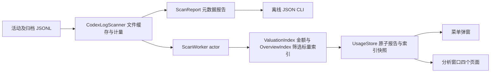

# Codex Stats 设计基线与重建入口

文档更新：2026-10-16。实现基线：2026-10-16，**v0.2.21 / build 23 的当前源码**。设计目的：另一位开发者根据本文和明细、合成验收数据，重建统计口径、布局与交互基本一致的原生 App。

## 文档权威与状态

| 文档 | 负责内容 | 状态 |
|---|---|---|
| [趋势三指标](overview-trend-design.md) | Token/记录数/参考USD趋势及未知边界 | 已实现v0.2.21；R23/T16 |
| [删除独立模型统计页](remove-model-statistics-design.md) | 四页导航、重复UI移除与保留边界 | 已实现v0.2.19；R22 |
| [清爽总览与模型筛选](dashboard-model-filter-design.md) | 四卡、模型联动与新增默认价 | 已实现v0.2.18；R21/T15 |
| [模型价格管理](model-price-management-design.md) | 全历史候选、本地价表编辑/删除及版本重算 | 已实现v0.2.17；生效价表与受保护删除 |
| [缓存率与美元估算](cache-rate-cost-design.md) | 新增派生指标、定价与未知边界 | 已实现v0.2.16；参考价及覆盖边界已验证 |
| [产品需求](requirements.md) | 产品范围、R/T 验收编号 | 当前基线 |
| [当前 UI 设计](ui-design.md) | 页面结构、尺寸、字体、颜色、交互、状态 | 已实现 v0.2.21 |
| [数据与统计设计](data-design.md) | 输入协议、数据结构、计量、去重、性能字段与聚合 | 计量沿用v0.2.11；v0.2.16新增派生缓存率/金额 |
| 本文 | 架构、状态流、偏好、生命周期、构建和重建验收 | 已实现 v0.2.21 |
| [原生 D 与双配色](native-cyan-blue-design.md) | D 单一布局、先浅青后晴蓝、主题偏好与验收 | 已实现 v0.2.13；原生合成及状态测试通过，人工交互另验 |
| [模型页布局提案](model-layout-proposals.md) | 模型 A 分组列表原生契约与三版比较 | 历史v0.2.15；独立页已于v0.2.19删除 |
| [请求页紧凑布局](request-density-design.md) | 请求页头部、响应式原生表格与详情面板 | 已实现 v0.2.14；覆盖v0.2.13请求页几何 |
| [青灰与青绿精修](sage-teal-design.md) | 动态配色、分层、原生表格与选中态 | 历史 v0.2.12；颜色已被双配色取代 |
| [B 视觉目标](ui-design-b.md) | 用户选定的菜单方向、生产参数、原型参考 | 已实现菜单B；分析窗口采用D布局 |
| [原生方案比较](menu-design-comparison.html) | A/B 合成数据截图 | 设计参考，非运行时切换 |
| [.trellis/spec](../.trellis/spec/guides/index.md) | 开发时必须执行的详细契约和检查 | 已建立条目有效，初始化占位不算规范 |
| [使用指南](usage.md) / [统计说明](statistics.md) / [开发指南](development.md) | 从首页拆出的安装、操作、统计边界和验证命令 | 当前实现说明，契约以设计文档为准 |
| [VERIFICATION](../VERIFICATION.md) | 实际命令、历史测试、环境、未验收限制 | 证据，不是功能目标 |

**未来以设计文档为开发依据：先更新需求和目标设计，再实现。** 已实现与待实现必须明确标记。若源码与已实现设计矛盾，先核对并记录差异，修正文档或代码；不能擅自以旧代码覆盖已批准目标，也不能将目标直接标成已交付。只有实现与验证完成才推进基线版本。具体流程见 [Design-first workflow](../.trellis/spec/guides/design-first.md)。

B 菜单已接入生产实现，宽 288 pt；总量卡加 2×2 指标卡。分析窗口采用D布局，默认浅青、可选晴蓝，跟随系统明暗。此前大弹窗、科学计数法和多实例等问题的历史修复证据留在 VERIFICATION，不作为另一套可选产品行为。

## 产品与架构决策

只分析本机 Codex 日志。准确性优先于完整性：不能证明的所有权、模型、日期、缓存及性能保持未知或排除并诊断。总量只等于输入加输出；缓存是输入子集，推理是输出子集。没有订阅剩余额度、登录、网络调用、价格服务或云同步。

选择 SwiftUI、Charts 和少量 AppKit：保持原生菜单、窗口和表格；AppKit 仅承担生命周期、菜单窗口关联、复制等系统交互。Core 仅依赖 Foundation，App 和离线核对 CLI 使用同一计量报告，避免两个统计口径。没有第三方运行时依赖、数据库或持久扫描缓存。



| 模块 | 必须承担的职责 |
|---|---|
| Sources/Core/Models.swift | Token、记录、会话、模型、诊断、日期边界和聚合 |
| Sources/Core/OverviewIndex.swift | 后台标量模型/范围/小时及记录数摘要，不持有原始记录 |
| Sources/Core/UsageValuation.swift | 缓存率、Decimal参考价估算、标量范围索引及CLI派生状态 |
| Sources/Core/CodexLogScanner.swift | 输入协议、所有权、物理历史、去重、计量与文件缓存 |
| Sources/App/Appearance.swift | 固定浅青/晴蓝环境颜色角色，跟随系统明暗 |
| Sources/App/UsageStore.swift | 串行扫描 actor、刷新排队、可见状态、偏好、独立的单项普通/总览摘要 |
| Sources/App/CodexStatsApp.swift | 唯一 Store、MenuBarExtra.window、dashboard Window、⌘Q |
| Sources/App/AppLifecycle.swift | 常驻策略、重复实例处理、弱关联菜单窗口 |
| Sources/App/Components.swift | 主题、字体层级、统一数字、共用组件 |
| Sources/App/MenuPanelView.swift | 快速统计及关闭菜单后打开分析 |
| Sources/App/DashboardView.swift | 四页导航、共享筛选与Overview |
| Sources/App/RequestsContent.swift | 已计入记录表格、筛选、排序及右侧 inspector |
| Sources/App/SessionsContent.swift | 会话拆分、设置及诊断呈现 |
| Sources/Report/main.swift | 同一 Core 的离线 JSON 输出，--records 可选 |

目录是实现定位，不要求重建者逐文件照抄；数据和交互契约必须相同。

## 状态与刷新设计

App 创建一个 `@StateObject UsageStore`，菜单和分析窗口共享同一实例与 `period`；不是每个窗口创建扫描器。Store 标记 `@MainActor`，`ScanWorker` actor 独占一个 `CodexLogScanner`，后台串行扫描。主线程只发布结果及视图状态。

### 状态字段

| 字段 | 初始值 / 含义 |
|---|---|
| snapshot / report | snapshot携带报告、标量估值、对应价表及全历史已用模型集合；report为只读计算属性。一次发布配对快照，不表示已成功零用量 |
| loading | false；开始扫描变 true |
| didScan | false；当前路径任一成功或失败完成后 true |
| lastSuccessfulRefresh | nil；成功时取 report.refreshedAt，失败保持 |
| hasReport | lastSuccessfulRefresh != nil，不以记录数量判断 |
| errorMessage | nil；当前路径失败时赋值，重试保留，成功或切换路径时清空 |
| rootPath | 下述偏好优先级决定 |
| period | today；不持久保存 |
| palette | cyan；保存选项，切换不触发扫描或摘要失效 |
| pendingRefresh | 私有 Bool；扫描期间刷新请求合并为一次后续扫描 |

### 转移契约

1. 初始化读取偏好，配置定时器，立即调用 refresh。
2. refresh 若正在扫描，只置 pendingRefresh；否则 loading=true、保留上次 error，捕获当前路径并启动 worker.scan。
3. 成功仅在捕获路径仍等于 rootPath 时发布报告与后台构建的估值索引快照、成功时间和 didScan。失败也仅更新当前路径的错误与 didScan；不清除已有成功数据。
4. 扫描结束置 loading=false；若 pendingRefresh 为 true，清零后再启动一次刷新。此设计不会为每次 30 秒 tick 建一个并发扫描。
5. updateRoot 去除首尾空白，空字符串不生效；有效路径重置报告与估值索引、成功时间、didScan 和错误，保存并刷新。旧路径结果不覆盖新路径。
6. 无成功报告时：扫描中显示加载；失败显示错误；成功零记录才显示空状态。已有成功报告时：刷新仍展示旧报告，刷新图标表示忙；失败提示仍可见，成功时间不前移。

### 偏好契约

| 键 | 类型 | 默认 / 读取优先级 |
|---|---|---|
| CodexPulseRoot | String | 保存值 → CODEX_HOME → 展开 ~/.codex |
| CodexPulseAutoRefresh | Bool | 未保存时 true |
| CodexStatsRefreshIntervalSeconds | Int | 30；非法枚举值也取 30 |
| CodexStatsColorPalette | String | cyan；允许cyan/blue，缺失或未知值取cyan |

刷新可选 **30、60、300、900 秒**；自动刷新可关闭。更改间隔或开关保存并销毁旧 Timer，开启时创建重复 scheduledTimer，以新间隔重新计时。计时器弱捕获 Store；该设置动作本身不立即扫描。Finder 启动不保证继承 shell 环境，目录应可在设置中指定。旧 CodexPulse 键是当前实际偏好协议，不应仅为改名增加第二套存储。

## 生命周期与系统身份

| 项 | 当前契约 |
|---|---|
| 显示名称 / .app | Codex Stats / Codex Stats.app |
| 可执行文件 | CodexStats |
| bundle identifier | dev.codexpulse.local |
| 版本 / build | 0.2.21 / 23 |
| 最低系统 | macOS 14.0 |
| LSUIElement | true；菜单栏应用，不依赖 Dock 窗口驻留 |
| 分析场景 | Window id=dashboard，默认 1120×760 pt，contentMinSize |
| 菜单 | MenuBarExtra .window，图标 waveform.path.ecg.rectangle |

AppDelegate 在 willFinishLaunching 启用 automaticTerminationSupportEnabled，然后调用 disableAutomaticTermination("Codex Stats menu bar resident")；Info.plist 也声明支持自动终止。最后一个窗口关闭时 applicationShouldTerminateAfterLastWindowClosed 返回 false。明确退出按钮和 ⌘Q 调用 NSApp.terminate(nil)。不阻止睡眠、不实现登录自启、守护进程或崩溃自动重启；不能据此承诺进程永不消失。

重复实例用相同 bundle ID 查询未终止的 NSRunningApplication，按 launchDate 再 PID 升序选已有最早实例。新进程不是最早实例时，激活已有实例并自行退出。它不删除安装副本，也不保证旧版二进制实现同样策略；更新前用户仍应退出旧版。

`MenuWindowProbe` 捕获菜单 NSView 所在 NSWindow，`MenuWindowOwner` 弱持有。打开分析的顺序是 **close 菜单自己的窗口 → openWindow(id: dashboard) → 激活 App**。不要使用 NSApp.keyWindow 推断菜单，焦点可能已属于分析窗口。Probe 脱离时只有 owner 仍指向自身旧窗口才清空，防止过期视图删掉新的关联。诊断入口复用此顺序。

## 性能、隐私与权衡

使用文件级缓存（路径、大小、mtime）和 64 KiB 分块读取；变化文件重读，未变文件复用解析元数据，消失文件移除。每读块和 JSON 行局部 autoreleasepool 限制 Foundation 临时对象积压。缓存保留 Token、身份、模型、时间、项目目录和计量证据，不保留正文。内存仍随有效元数据数量增长，不能称为固定内存。

不读取 auth.json、配置密钥或数据库，不上传日志，不跟随 JSONL 符号链接。多个扫描根用英文逗号分隔；扫描根目录规则、字段校验和诊断详见数据设计。

原生所有权必须由真实 session_meta ID 证明，内部归组标识不参与认证；缺少真实 ID 的会话显示“未记录”并禁用复制。具体归组、重复副本和通知去重边界见数据设计及 T04/T06。

当前没有字节级追加、文件监听或持久缓存：降低复杂度，代价是首次全量读取和增长文件重新解析。`cold` 是新进程解析器缓存为空，不是清系统磁盘缓存。RSS、当前 footprint、峰值 footprint 和虚拟空间必须分别记录；扫描 CLI 不代表完整 UI App。性能指标按固定输入比较，同时核对精确计量快照，不能牺牲统计降低内存。

## 构建与交付重建

Swift Package 工具版本 6.0，语言模式 Swift 5；Core、CLI、Swift Testing 测试，macOS 条件加入 App 目标。正式 .app 用 build-macos.sh 直接编译 Core 与 App、系统 SwiftUI/Charts/AppKit，`-O -swift-version 5 -parse-as-library`，目标为当前机器架构的 `*-apple-macosx14.0`，不是 universal binary。

```bash
./Scripts/test.sh
./Scripts/build-macos.sh /tmp/codex-stats-rebuild
codesign --verify --deep --strict "/tmp/codex-stats-rebuild/Codex Stats.app"
open "/tmp/codex-stats-rebuild/Codex Stats.app"
# 生成 DMG 会重新在 dist 构建 App
./Scripts/make-dmg.sh
```

构建在目标卷的唯一暂存目录中编译并拷贝 Assets/Info.plist，通过系统 sips/iconutil 由 Assets/CodexStats-1024.png 生成 icns，使用 `codesign --sign - --timestamp=none` ad-hoc 签名。系统帮助程序核对身份、版本、可执行文件及 strict codesign 后，以 Darwin 原子交换发布；新目标使用排他 rename。编译或校验失败保留旧 App。make-dmg.sh 将 App 和 /Applications 链接装入 UDZO DMG，删除 staging，保留 dist 构建 App。

install-local.sh 默认安装到 ~/Applications/Codex Stats.app，可用 `--source` / `--destination` 指定本地路径。帮助程序先在独立临时目录编译，源/目标嵌套、同路径、符号链接、身份及运行实例检查通过后才写目标父目录。复制暂存后再次校验，发布前再次检查运行实例；任一同 bundle 实例运行时拒绝安装，要求用户手动退出，不自动终止。原子替换后旧 App 暂存副本在启动验证成功后清理；发布或启动未确认则保留并报告位置。启动核验新 PID、启动时间、bundle/可执行路径、磁盘版本和散列；不是 App 内业务就绪握手，无法锁住外部同时启动或保证断电后的磁盘持久性。详见 [开发指南](development.md) 和 [本地交付契约](../.trellis/spec/backend/local-delivery.md)。不要为了验证文档反复安装并制造 Launchpad 副本。

交付源码应包含 Package.swift、Sources、Tests/Fixtures、Scripts、Assets、当前 docs、README、VERIFICATION、AGENTS 和必要 Trellis 规范/任务。不得包含真实 JSONL、认证资料、构建缓存和个人 journal。源码文档更新不等于 DMG 二进制更新；只有产品实现改动才另行发布版本。

## 重建验收矩阵

| 验收目标 | 自动/静态证据 | 必须补充的实际检查 |
|---|---|---|
| 计量与数据关系 | Scripts/test.sh；数据设计的案例；同范围记录/模型/会话合计一致 | 同一冻结真实日志独立核对，明确差异口径 |
| 单位与未知状态 | Scripts/test-token-display.sh，真实 shared formatter 三区域设置 | 量级变化/长名称可读，精确值可查 |
| 刷新状态 | Scripts/test-usage-store.sh | 首次加载、错误目录恢复、定时刷新不重复扫描 |
| 菜单关闭与常驻 | Scripts/test-menu-lifecycle.sh、test-app-lifecycle.sh | 点分析/诊断后弹窗收起，关闭分析后菜单保留，退出结束进程 |
| UI 参数与状态 | Scripts/render-ui-previews.sh，ui-design 状态矩阵 | 搜索/排序/复制/缩放/深浅色/详情关闭实际操作 |
| B 菜单 | Scripts/render-ui-previews.sh 生产视图；render-menu-designs.sh 保留原型 | 生产静态渲染不替代真实菜单点击 |
| 性能 | Scripts/benchmark-performance.sh、measure-app-memory.sh | 固定输入，记录宿主/版本/架构/指标定义；长期运行观察 |
| 安装 | 原生构建、签名、DMG 检查 | 目标 Mac 从 Applications 运行，macOS 14/Intel 单独验收 |

目前历史验证宿主为 macOS 27.0.1 / Apple Silicon；已有自动测试、原生编译和静态预览证据见 VERIFICATION。**静态渲染不证明点击成功，源码策略不证明长期不崩溃。** macOS 14、Intel、Developer ID、公证及真实交互仍有未完成项；本轮新增证据见 VERIFICATION，未执行的交互和平台检查保持待验收。

## 仓库与目录规范

目录边界、命名依据、Git 忽略策略及开源准备见 [源码仓库设计](repository-layout.md)。该设计记录源码、开发工具和生成物的公开边界。

## 设计决策的可追踪修改

每次变更用 Trellis 任务引用 R/T 编号，在目标设计中写：触发原因、现状、目标状态、影响的数据/页面/状态、替代方案与取舍、验收命令/人工步骤、明确延期项。改数字单位需追查所有共享显示位置；改计量需同时约束 CLI、列表和图表；改窗口需核验菜单窗口身份与进程生命周期。

2026-10-15 已按用户要求初始化 Git，并提交推送至公开仓库 [lixd/codex-stats](https://github.com/lixd/codex-stats)，默认分支 main。原创 App 使用 MIT，Trellis 上游材料保留 AGPL-3.0-only；发布证据见 VERIFICATION。初始化前的无 Git 状态仅为历史证据。仓库边界和后续公开准备以源码仓库设计为准，不将旧任务自动 base_branch 当作真实提交证据。


## v0.2.10 第一批精修

关联任务 10-15-refinement-review（R01/R07/R13/R14/R17、T04/T06）。实现真实会话身份边界、当前范围摘要复用、B菜单和中文指标文案。没有分析窗口大改、持久缓存、数据库或追加解析，默认30秒不变。

`UsageStore.summary` 返回 `UsageSummary`（总量、模型、日与今日小时汇总）；仅缓存一个键/值，不保留原始记录。键含报告修订、范围、本地日期、时区标识及当时 UTC 偏移，成功报告/切换根路径清空；失败保持旧成功报告与摘要。同一天同范围重复绘制复用对象。会话每次 body 捕获同一个 now，预计算各会话总量/模型，筛选排序和选中查找只做一次；比较器不聚合用量。请求页底部合计也仅计算一次。

时区键失效不代表重建扫描桶：扫描器启动时固定时区，本轮未实现运行中跨系统时区重新分桶，系统时区变化后应重启 App。测试仅验证键变化与原有本地日筛选，不能声称时区切换后的实际聚合已验证。

## 审查修复：已实现（2026-10-15）

用户批准的A01–A06已于v0.2.11/build13纳入源码：计量重发与未知子项（T01/T03/T04/T06/T08）、Turn与会话查询性能（R02/R07/R13/R16、T09–T11）、跨页异常状态（R04/R11）、安全本地替换（R14/R17）。[审查修复设计](audit-fixes-design.md)在实现前获批，契约现已同步本文；133项Core测试、126组合成差分、18项真实交付检查、原生构建及受控基准见[本轮验证](../VERIFICATION.md#v0211--build-13-审查修复2026-10-15)。未安装、提交、推送或发布；静态预览不代表实际点击验收。A07窄窗口布局继续延期。


## 青灰与青绿精修：已实现（2026-10-15）

用户批准的配色 A「Sage + Teal」在当时 v0.2.12/build14 源码实现（该颜色现已被v0.2.13双配色取代）。R01/R06/R07/R12/R17：分层背景、青绿趋势与选中态、原生模型表去除空斑马纹；菜单仍为 B，统计与窗口几何不变。[配色设计](sage-teal-design.md)先于实施，任务见 [10-15-sage-teal-refinement](../.trellis/tasks/archive/2026-10/10-15-sage-teal-refinement/prd.md)。本轮 133 Core 测试、数字格式/Store/菜单宿主、88 张原生合成深浅色预览和优化构建通过，详见 [验证记录](../VERIFICATION.md#v0212--build-14-青灰与青绿精修2026-10-15)。实际系统增强对比度切换、鼠标及 VoiceOver 操作保持待验收；未安装或操作用户 App，未提交、推送或公开发布。

## D 原生布局与双配色：已实现

用户选择 D 布局，配色支持浅青和晴蓝，先完成浅青后增加晴蓝。[目标契约](native-cyan-blue-design.md)取代全面布局延期的本次相关范围。先记录固定浅青的D门禁，再加入晴蓝和设置切换，最终源码/独立构建v0.2.13/build15。配色通过共享Store环境传递，保持当前视图身份；只写偏好，不重置搜索/筛选/排序/选择、不扫描或清摘要。T01–T11、扫描和生命周期不变。两配色各120张原生合成预览、同宿主搜索/请求选择/目录草稿及颜色重绘、133 Core测试和优化构建通过；非默认Picker操作、sheet、实际增强对比度、VoiceOver等仍待人工验收，见[本轮验证](../VERIFICATION.md#v0213--build-15-d-布局与双配色2026-10-15)。

## 请求日志紧凑布局：已实现（2026-10-15）

R04/R08/R09/R12/R17：[请求紧凑目标](request-density-design.md)收紧本页头部/筛选/列宽；保留D布局双配色和全部字段。v0.2.14/build16：请求页单行头部，表可用宽900pt为界切换十列/七列相关字段组合，全部信息保留且无横向溢出；详情改420×600原生sheet避免挤压列表。其他页面和统计不变，证据见[验证记录](../VERIFICATION.md)。

## 模型 A 分组列表：已实现

R04/R06/R12/R17：[A原生契约](model-layout-proposals.md)取代模型页旧八列Table。v0.2.15/build17：保留共享数据和六种排序/搜索；每模型名称/会话/总量在上，输入/输出及缓存/非缓存/推理分区在下。纵向LazyVStack不新增选择状态；950/1120普通与legacy无横向溢出、80模型末项可达，现有浅青/晴蓝两配色保持。统计/Core/Store/其他页面不变；实际证据及人工边界见[验证记录](../VERIFICATION.md)。


## v0.2.17 本地价格状态补充

价格模块独立于Scanner：PriceCatalog/ModelPrice保持完整有效表、三项精确Decimal、修订及来源；PriceCatalogFile共享App/Report读取路径。UsageStore在同一ScanWorker串行读写价表、扫描、构建估值；修改先持久化，再以价格修订/报告代次校验重算结果，保留旧快照至原子发布。初次坏配置仍显示Token，金额不可估；已有成功配置时保留旧值并显示错误。价格操作不重读JSONL，不增加Timer。设置子页/候选/保护删除与本地文件契约详见[价格管理设计](model-price-management-design.md)。


## v0.2.18 清爽总览与模型筛选

R21/T15：[正式契约](dashboard-model-filter-design.md)已实现并完成本轮自动验收。四张独立卡为API等值估算、总Token、缓存率、用量记录数；总览局部模型选择与共享时间范围共同约束趋势、模型分布和完整Token明细。选择不影响菜单或其他页面；查看用量记录带入模型。后台OverviewIndex只保留标量桶；Store另有单项筛选摘要缓存，查询不扫描日志，价格重估复用用量索引。两个新默认价及显式补充规则见契约。145项Core、独立手算/真实CLI合成核对、Store与双配色原生矩阵和独立构建见[本轮证据](../VERIFICATION.md#v0218--build-20-清爽总览与模型筛选2026-10-15)。鼠标操作、VoiceOver及macOS14/Intel实机仍待验收。


## v0.2.19 删除重复模型统计页

R22覆盖R04/R06独立页面部分：[删除契约](remove-model-statistics-design.md)。侧栏只保留总览、请求日志、历史会话、设置；默认总览。独立ModelsContent/ModelUsageGroup及专页搜索排序移除，总览模型下拉/分布/完整Token明细、请求筛选、会话内模型拆分和设置价格管理保留。Core/Store聚合不变。本轮原生四页/总览矩阵、独立typecheck与构建证据见[验证记录](../VERIFICATION.md)。


v0.2.20/build22（R21/T15）：总览模型下拉按当前范围已接受记录数降序，同数模型ID升序；全部模型独立固定首项，零记录候选与选择保持。仅私有UI排序变化，无统计或价表变更。完整契约见[总览筛选设计](dashboard-model-filter-design.md)，证据见VERIFICATION。


v0.2.21/build23（R23/T16）：总览趋势原生Token／记录数／API等值金额切换；同模型/范围与后台标量日/小时桶、部分/未知金额标记及密集日期可读性，见[正式契约](overview-trend-design.md)。本轮证据见VERIFICATION。
