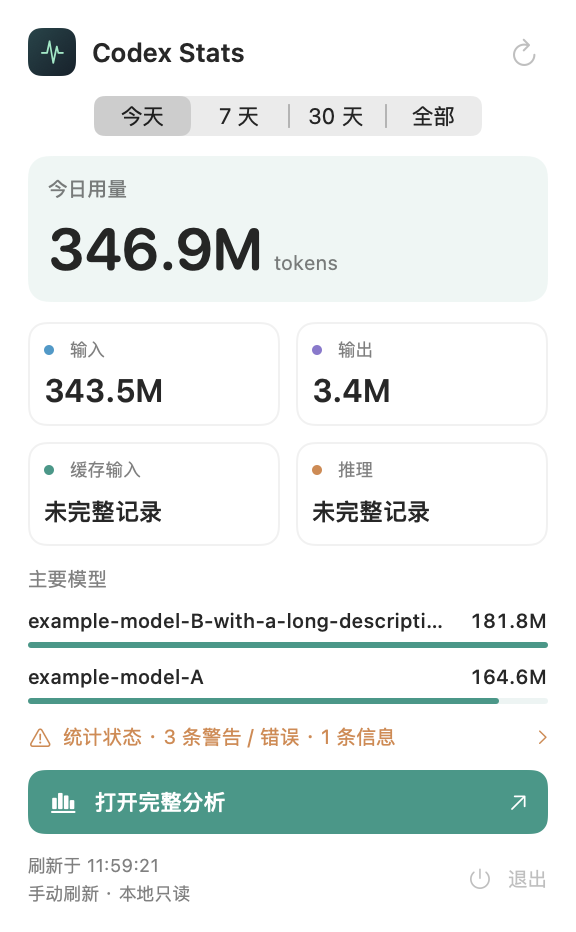
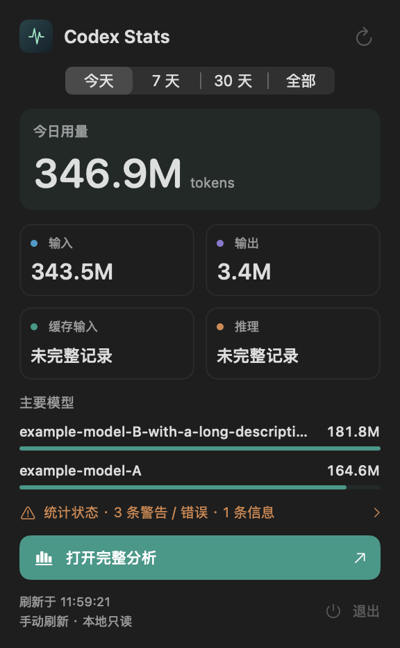

# 菜单 B：轻量仪表盘设计与实现

## 状态与适用范围

用户明确选择“B 好看，高级”，并于 2026-10-15 批准生产接入。**B 已在 v0.2.10 / build 12 源码实现，并通过原生合成预览；真实菜单点击和 macOS 14 实机验收仍独立待验。** 当前生产菜单的重建参数见 [当前界面设计](ui-design.md)。保留原型及选择历史，不能将原型截图当作运行证据。

B 仅改菜单的视觉层级与指标布局；分析窗口、离线日志统计、时间范围、刷新、退出、窗口关闭行为沿用当前设计。菜单没有A/B布局切换、多Provider或订阅额度功能；v0.2.16在原卡片内补充参考金额与缓存率，见[派生指标设计](cache-rate-cost-design.md)；v0.2.13增加浅青/晴蓝配色选择，菜单结构仍为B，详见[当前双配色](native-cyan-blue-design.md)。当前参考原型在 `Tests/MenuDesignPrototype/main.swift` 的 `MenuProposal(dashboard:true)`；对比入口 [A/B 预览](menu-design-comparison.html)。

## 为什么选这个方向

在288pt窄宽度内，以一块总量卡建立第一视觉焦点，再用2×2小卡分开输入/输出/缓存/推理。数字和标签各占一行，比标签与数字挤在同一行更适合快速扫读；底部主操作继续用品牌色，模型条帮助比较排行。语义背景、细描边、系统字体实现层级，不依赖大面积装饰、网页或额外依赖。

B 的四卡结构比 A 的单行列表更高。历史原型约 288×469pt；生产合成预览正常状态为 288×466pt，均来自 fittingSize，没有固定 height。加载 288×270、空态 288×409、错误 288×306、完整字段单一 Unknown model 288×415pt；高度随内容、诊断、系统字体变化。没有进一步压紧纵向间距的目标；若后续调整，应先更新设计再实现。

## 可复建视觉参数

使用现有CPTheme、CPLogo与abbreviated，颜色精确值和格式规则见当前界面设计。整体左对齐VStack间距10，外padding14，固定宽288，有效宽260，CPTheme.viewBackground（当前浅青/晴蓝环境配色，见配色契约），内容自适应高度。

| 区域 | 当前生产参数（几何沿用v0.2.10） |
|---|---|
|品牌头|HStack间距8，Logo24，产品名13/semibold，右刷新符号secondary；24×24标签区、扫描时spinner+disabled、状态可访问性标签|
|时间选择|今天/7天/30天/全部，segmented、small、labelsHidden、宽260|
|总量卡|padding10，corner10，selection背景，撑满内容宽；内部间距6|
|总量标签|10/medium/secondary；今天为今日用量，其他所选范围rawValue加用量|
|总量数字|29/semibold/rounded、等宽数字、单行最小缩放0.65；tokens10/secondary；基线对齐横距5|
|四卡|LazyVGrid两列flexible，行间距8；默认列间距由GridItem系统默认决定，未显式锁定|
|小卡|内padding8，圆角9，cardBackground，stroke；内部间距6、撑满单元宽、左对齐|
|小卡标签|输入/输出/缓存输入/推理，Label(circle.fill)9，分别cyan/purple/accent/orange|
|小卡数值|已知16/semibold/等宽，未知为未完整记录12/semibold；单行、最小缩放0.65、最小数值区高19；字段和精确值help/无障碍标签|
|模型区域|内部间距8，标题主要模型10/secondary，前两名|
|模型行|名称和值10/medium，名称单行截断并帮助全名，值固定固有宽并帮助精确值；行与条间距4|
|模型条|高3，底accent×0.10，前景accent，按第一名归一化；不强制最小宽|
|统计提醒|横距5，警告/错误orange，纯信息accent，文字10，尾箭头8，真实诊断数量|
|分析按钮|文字11/medium，横padding10、竖9、圆角8；actionFill背景、白字、右箭头；无边框|
|底部|左两行9/secondary、间距3；右power+退出10/secondary，标签最小24×24，可访问性退出Codex Stats并保留quit-app|

原型未指定图标命中区，生产补充刷新/退出最小24pt。App外部弹窗阴影、外部圆角及未指定的系统控件字体由MenuBarExtra.window系统容器决定。不能从PNG添加未经确认的玻璃材质或强制固定OS装饰。

## 原型数据与复现

现有原型固定以下**合成**内容：总量306.08M；输入304,810,000、输出1,270,000、缓存297,240,000、推理437,800；模型gpt-6.1-sol 301,460,000和Unknown model 4,620,000；模型条比例1与0.0153；8条统计提醒；刷新于21:57:09、每30秒·本地只读。

这些数字仅用于视觉比较，不能冒充实际会话，也不要求与原型其他标签组成全局统计一致性。生产必须由同一次ScanReport/当前时间范围实时计算，模型名称自动识别；未知与缺失字段规则照旧。

运行 `Scripts/render-menu-designs.sh` 生成四张原生A/B深浅色PNG和两张对比PNG；B单图@2x宽576像素，原型每张用对应aqua/darkAqua。截图采集由NSHostingView离屏渲染；这不是可点击App，不证明刷新、退出或真实菜单交互。对比HTML内嵌图片用于静态选择，不读用户日志、不写偏好。

## 生产契约

- 时间Picker绑定共享store.period；总量标签使用所选范围，不能固定“今日用量”。
- 真实total=input+output；缓存包含在input、推理包含在output。所有Token文本走统一K/M，不把未知字段显示为0。
- 启动首扫没有报告时显示读取中/尚未取得用量，不出现真实0错觉；已成功数据后台刷新保留，失败显示错误及原来的成功时间。
- 模型前2名按实际范围排行；长名字单行截断并帮助全名，Unknown model完整可识别；字段“未完整记录”不溢出小卡。
- 统计提醒继续区分警告/错误与信息，数量来自全部扫描诊断；详情到分析窗口，不在菜单展开长告警。原型“8条统计提醒”是占位，不是新的统计口径。
- 刷新是真实button，扫描时spinner+disabled；分析按钮必须先关闭本菜单hostingwindow再open/activate dashboard；退出是真实NSApp.terminate并保留⌘Q。
- 深浅色保留语义背景；数字hover保留完整整数；可访问性标签和quit-app等现有标识保留。

## 实施记录与后续验收

2026-10-15 已通过 Trellis 任务完成文档先行、生产接入与原生预览。`Scripts/render-ui-previews.sh` 使用真实 SwiftUI 视图和合成扫描报告，验证 288pt fitting 宽度、四种范围、首扫（扫描前后状态断言）、空态、失败、未知字段、长名称、Unknown model 和完整已知字段，深浅色均覆盖。`Scripts/test-token-display.sh` 验证三种 locale 的共享数字契约。菜单关闭代码沿用精确 hostingwindow 的所有权与顺序，不通过原型证明鼠标交互。

后续仍需真实点击菜单→完整分析/诊断，确认弹窗收起、关闭分析仍驻留、显式退出和⌘Q有效；macOS14实机独立验收。静态预览不证明上述操作。实际执行命令和证据统一见 [VERIFICATION](../VERIFICATION.md)。

| 验收情景 | 成功标准 |
|---|---|
|正常用量|总量卡+四卡+模型条符合上述层级，精确值可查|
|四种范围|范围共享、数字和主标签同步变化，无固定今日文案|
|缺失字段/长名称|未知含义保留，卡内不溢出，模型值可读|
|加载/失败|首扫不伪装0；旧结果不被失败覆盖；错误可见|
|提醒|信息和告警数量正确，点击打开分析且关闭菜单|
|交互/驻留|刷新、退出、⌘Q真实有效，关窗口不退出|
|深浅色|背景遵循系统，文字/色点/数字/按钮清晰|

未验证：实际 MenuBarExtra 各状态点击、辅助功能操作、精确值 hover 和 macOS14 实机表现。生产源码及原生合成布局已实现，不将这些独立交互检查标为完成。

## 生产静态参考

以下由真实 MenuPanelView 使用合成数据离屏渲染（2026-10-15），不是用户日志或点击验收。参数和状态以上文为准。

| 浅色 | 深色 |
|---|---|
|  |  |

v0.2.12保留本文B菜单几何与交互，共享色彩按[青灰与青绿设计](sage-teal-design.md)更新：总量卡selection，白字主操作actionFill，信息诊断accent。原型图片只代表历史比较，不覆盖当前颜色契约。
